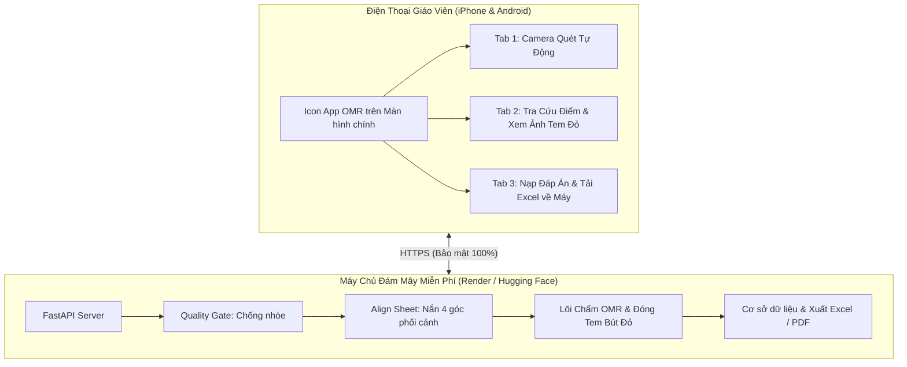

# HƯỚNG DẪN TRIỂN KHAI APP CHẤM THI DI ĐỘNG ĐỘC LẬP (0 ĐỒNG - KHÔNG CẦN PC)

Tài liệu này hướng dẫn chi tiết cách đưa hệ thống **OMR_EXAM_SYSTEM** lên máy chủ đám mây miễn phí và cài đặt ứng dụng lên điện thoại thông minh (iPhone & Android) để giáo viên sử dụng hoàn toàn độc lập mà không cần bất kỳ chiếc máy tính nào can thiệp.

---

## 1. TỔNG QUAN KIẾN TRÚC ĐỘC LẬP



---

## 2. CHỌN NỀN TẢNG CLOUD MIỄN PHÍ

Bạn có thể chọn **1 trong 2 nền tảng miễn phí 100%** dưới đây:

### LỰA CHỌN A: Render.com (Khuyên dùng - Cực kỳ phổ biến, dễ dùng)
- **Chi phí:** 0 VNĐ (Gói Free Web Service vĩnh viễn).
- **Tên miền:** Cấp sẵn link HTTPS miễn phí (ví dụ: `https://omr-exam-system.onrender.com`).
- **Thời gian triển khai:** ~5 phút.

**Các bước thực hiện:**
1. Tạo tài khoản miễn phí tại: [https://render.com](https://render.com).
2. Đẩy thư mục mã nguồn dự án này lên tài khoản **GitHub** của bạn (chế độ Public hoặc Private).
3. Trên Render Dashboard, bấm **New +** $\rightarrow$ Chọn **Web Service**.
4. Chọn repository GitHub vừa tạo.
5. Cấu hình các thông số:
   - **Name:** `omr-cham-thi` (hoặc tên tùy thích).
   - **Environment / Runtime:** Chọn **Docker** (Hệ thống sẽ tự nhận diện tệp `Dockerfile` đã chuẩn bị sẵn).
   - **Instance Type:** Chọn **Free** ($0/month).
6. Bấm **Create Web Service**. 
7. Đợi khoảng 2-3 phút để Render build Docker container. Khi hoàn tất, Render sẽ cấp cho bạn một đường link HTTPS có đuôi `.onrender.com`.

---

### LỰA CHỌN B: Hugging Face Spaces (Cấu hình cực mạnh: 16GB RAM Miễn Phí)
- **Chi phí:** 0 VNĐ.
- **Cấu hình:** 2 vCPU, 16GB RAM (chấm ảnh siêu nhanh, không bao giờ lo tràn bộ nhớ).
- **Tên miền:** Cấp sẵn link HTTPS miễn phí vĩnh viễn.

**Các bước thực hiện chi tiết:**
1. Tạo tài khoản miễn phí tại: [https://huggingface.co](https://huggingface.co).
2. Bấm vào ảnh đại diện góc trên phải $\rightarrow$ Chọn **New Space**.
3. Điền thông tin:
   - **Space name:** `cham_trac_nghiem` (hoặc tên tùy thích)
   - **License:** Apache 2.0 (hoặc MIT)
   - **Select the Space SDK:** Chọn **Docker** $\rightarrow$ Chọn **Blank**.
   - **Space Hardware:** Chọn **CPU Basic (Free - 2 vCPU, 16GB RAM)**.
4. **Đẩy toàn bộ mã nguồn lên Space qua Git:**
   - **Bước 4.1: Tạo Access Token trên Hugging Face** (Bắt buộc để Git xác thực quyền đẩy code):
     - Vào link: [https://huggingface.co/settings/tokens](https://huggingface.co/settings/tokens)
     - Bấm **Create new token** $\rightarrow$ Đặt tên token (ví dụ: `omr-upload`) $\rightarrow$ Chọn quyền **Write** $\rightarrow$ Bấm **Create token** và sao chép mã (dạng `hf_...`).
   - **Bước 4.2: Chạy lệnh đẩy code trong Terminal:**
     ```bash
     git remote set-url space https://<username>:<ACCESS_TOKEN>@huggingface.co/spaces/<username>/cham_trac_nghiem
     git push -f space main
     ```
5. **Kiểm tra tiến trình và lấy link sử dụng trên điện thoại:**
   - Sau khi lệnh push chạy xong, quay lại trang Space của bạn. Bạn sẽ thấy trạng thái chuyển sang **Building** (mất khoảng 2-3 phút để cài đặt OpenCV & FastAPI).
   - Khi hoàn tất, trạng thái chuyển sang **Running** màu xanh lá.
   - **Đường link dùng trên điện thoại (Direct URL):**
     `https://<username>-cham-trac-nghiem.hf.space/scanner`
     (Ví dụ: `https://duylinh2602-cham-trac-nghiem.hf.space/scanner`).
     Mở link này trên điện thoại để quét và chấm bài vĩnh viễn.

---

## 3. CÀI ĐẶT ỨNG DỤNG LÊN ĐIỆN THOẠI (PWA)

Sau khi có đường link Cloud (ví dụ: `https://omr-cham-thi.onrender.com`), hãy gửi đường link này qua Zalo hoặc tin nhắn cho chính bạn và đồng nghiệp.

### A. Đối với iPhone / iPad (Trình duyệt Safari)
1. Mở đường link trên bằng trình duyệt **Safari**: `https://<ten-mien-cua-ban>/scanner`.
2. Bấm vào biểu tượng **Chia sẻ (Share)** ở thanh công cụ dưới đáy màn hình (hình vuông có mũi tên hướng lên ⬆️).
3. Cuộn xuống và chọn dòng **"Thêm vào Màn hình chính" (Add to Home Screen)**.
4. Bấm **Thêm (Add)** ở góc trên bên phải.
5. 👉 Ngay lập tức, trên màn hình chính của iPhone sẽ xuất hiện biểu tượng ứng dụng **"OMR Chấm Thi"** với logo màu vàng xanh chuẩn. Khi chạm mở, ứng dụng sẽ chạy toàn màn hình y hệt app tải từ App Store.

### B. Đối với điện thoại Android (Samsung, Xiaomi, Oppo...)
1. Mở đường link trên bằng trình duyệt **Google Chrome**: `https://<ten-mien-cua-ban>/scanner`.
2. Bấm vào nút **"+ Cài App"** xuất hiện trên góc màn hình (hoặc bấm dấu 3 chấm góc trên bên phải $\rightarrow$ Chọn **"Cài đặt ứng dụng"**).
3. Xác nhận **Cài đặt**.
4. 👉 Ứng dụng sẽ được đưa ra màn hình chính, có icon riêng, hỗ trợ chạy mượt mà không có thanh địa chỉ web.

---

## 4. QUY TRÌNH SỬ DỤNG 100% TRÊN ĐIỆN THOẠI CỦA GIÁO VIÊN

Giáo viên mang điện thoại lên lớp và thực hiện toàn bộ quy trình mà không cần bất kỳ chiếc máy tính nào:

### Bước 1: Nạp File Đáp Án (Tab "Đề & Xuất File")
- Mở ứng dụng $\rightarrow$ Chuyển sang Tab **"Đề & Xuất File"**.
- Bấm nút **"📄 Nạp File Đáp Án (Excel)"** $\rightarrow$ Chọn file Excel đáp án lưu trong Zalo/Google Drive của điện thoại.
- Hệ thống báo: *"✓ Nạp đáp án thành công!"*.

### Bước 2: Quét Chấm Tự Động (Tab "Quét Bài")
- Chuyển sang Tab **"Quét Bài"**.
- Đưa camera về phía bài thi trên bàn:
  - Khi 4 mốc góc chưa khớp: Màn hình hướng dẫn *"Dịch sang trái"*, *"Dịch lên trên"*, hoặc *"Cầm máy song song"*.
  - Khi khớp đủ 4 góc: Khung ngắm đổi sang **Màu Xanh Lá**, máy rung nhẹ và **Tự động chụp chấm**.
- Thẻ kết quả lập tức trượt lên báo: **SBD: 010203 - Mã đề: 101 - Điểm: 8.5 / 10**.
- Bạn có thể bấm nút **"Xem ảnh"** để phóng to bài thi đã được khoanh đỏ các lỗi sai, hoặc tiếp tục đưa máy sang bài thi tiếp theo.

### Bước 3: Tra Cứu & Đối Soát (Tab "Bảng Điểm")
- Bấm Tab **"Bảng Điểm"**: Danh sách toàn bộ học sinh đã chấm hiện ra theo thứ tự.
- Có ô tìm kiếm theo Số Báo Danh hoặc Mã Đề.
- Chạm vào từng học sinh để xem lại hình ảnh bài làm đã đóng dấu đỏ. Nếu bài nào quét lỗi hoặc quét trùng, bạn có thể bấm nút 🗑️ để xóa.

### Bước 4: Tải Bảng Điểm Excel Về Điện Thoại
- Vào lại Tab **"Đề & Xuất File"**.
- Bấm **"📊 Tải Bảng Điểm Excel (.xlsx)"**.
- Tệp bảng điểm sẽ được tải thẳng vào thư mục Tải về (Downloads) của điện thoại, giáo viên có thể mở bằng ứng dụng Excel trên điện thoại hoặc đính kèm gửi thẳng qua Zalo/Email cho tổ chuyên môn và phụ huynh.
